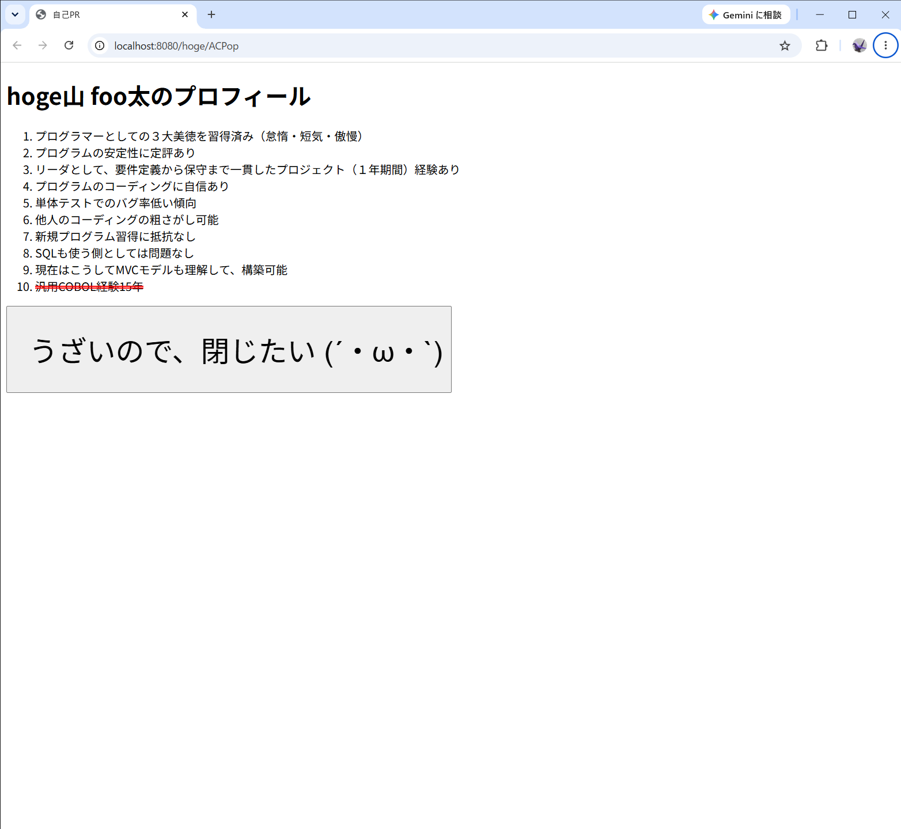
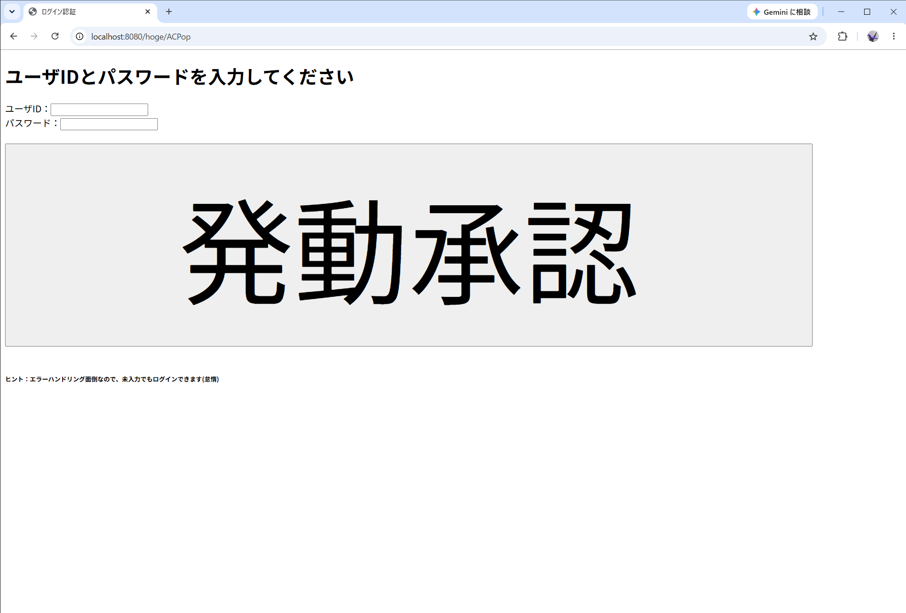
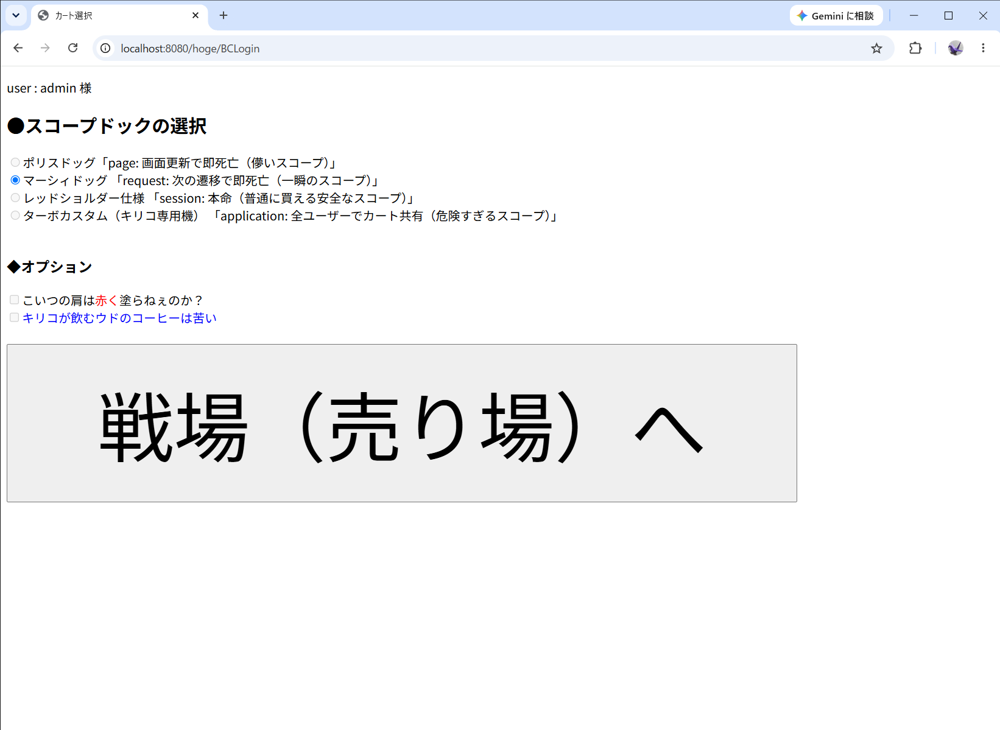
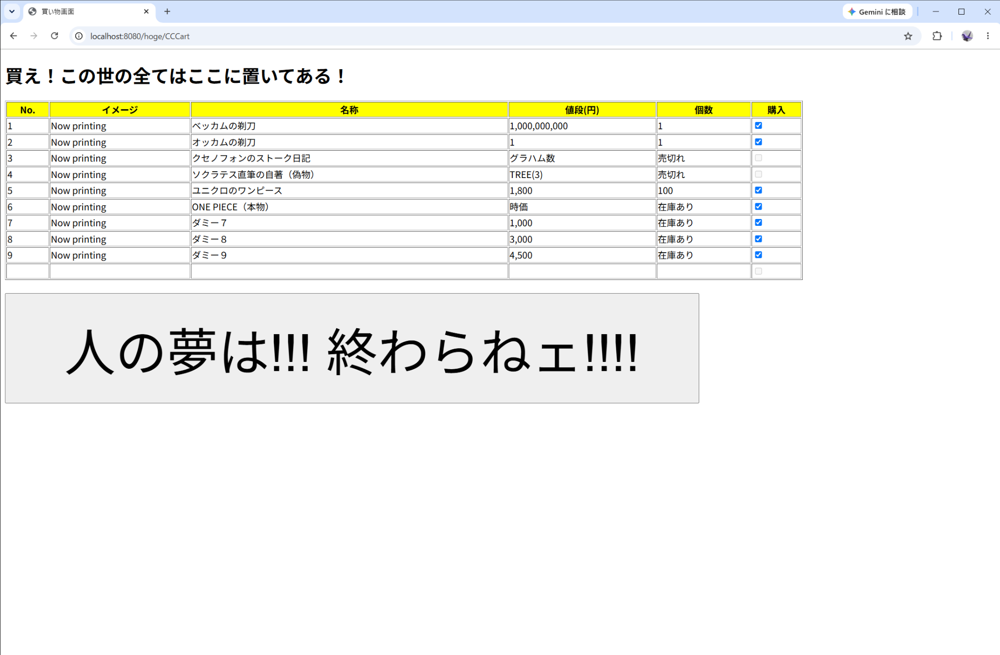
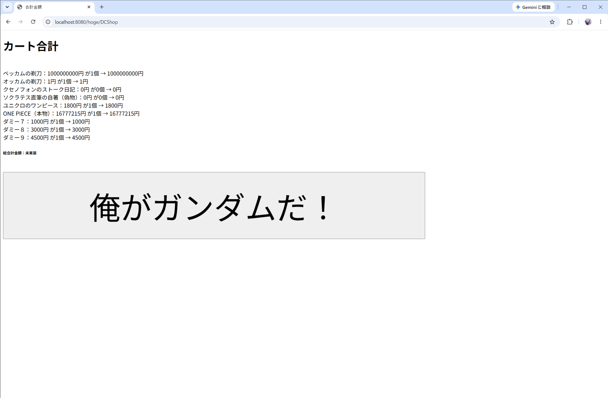
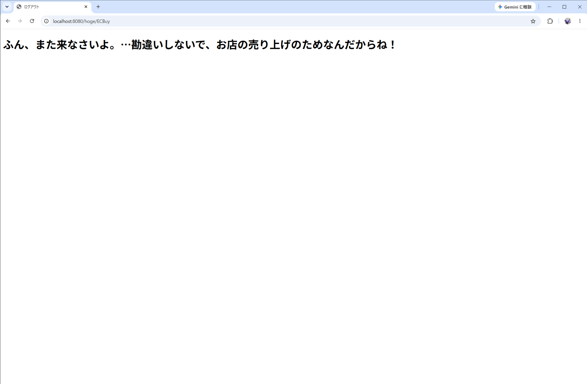

# Javaショッピングカート（Ver.0.01）

Java Servlet・JSP・JavaBeansを使用して制作した、**学習用の簡易ショッピングカートWebアプリケーション**です。

ログイン入力画面から商品選択、カート内容の確認、終了画面まで、画面間のデータの受け渡しと一連の画面遷移を実装しました。Ver.0.01では、**小さくても最後まで動くこと**を目標にしています。

画面内にはアニメ・漫画や哲学などを題材にしたパロディ表現が含まれます。実際の販売・決済を行うサービスではありません。

## 画面と操作の流れ

```text
プロフィール（開始）
        ↓
ログイン入力
        ↓
スコープ選択（Ver.0.01ではrequestを選択）
        ↓
商品一覧・チェックボックスで選択
        ↓
カート確認（商品名・単価・数量・小計）
        ↓
終了画面
```

### 1. プロフィール画面



### 2. ログイン入力画面

ユーザーID・パスワードを入力するための画面です。**本格的な認証処理ではなく、学習用の簡易実装**です。



### 3. スコープ選択画面

学習テーマである `page`・`request`・`session`・`application` の各スコープを画面に配置しています。Ver.0.01では選択肢を **request に固定**し、その他の選択肢とオプションは無効化しています。



### 4. 商品一覧画面

商品をチェックボックスで選択します。売り切れの商品は画面上で選択できません。



### 5. カート確認画面

選択結果をServletで受け取り、JavaBeansへ格納します。商品ごとの**商品名・単価・数量・小計**を表示します。



### 6. 終了画面



### 補足：選択状態による表示の違い

- [別ユーザー表示の例](screenshots/03_scope_other_user.png)
- [商品を選択していない状態](screenshots/04_shop_unselected.png)
- [未選択時のカート表示（数量0）](screenshots/05_cart_unselected.png)

## 実装した内容

- ServletからJSPへの画面遷移（`RequestDispatcher` によるforward）
- フォームの送信と、Servletによるリクエストパラメータの受け取り
- チェックボックスで選択された商品番号の取得
- 配列を利用した、商品番号と商品名・単価の対応付け
- `ItemJavaB` による商品名・単価・数量・小計の管理
- `CartJavaB` の `ArrayList` を利用した商品一覧の保持
- JSPのEL（Expression Language）を利用したカート情報の表示

**Ver.0.01の簡易仕様：** 商品は0始まりの番号で管理し、**選択した商品を数量1、選択しない商品を数量0**として、商品一覧をカートに格納します。JSP側では固定の添字で表示する方式を採用しています。

## 使用技術・開発環境

| 項目 | 内容 |
| --- | --- |
| 言語 | Java |
| Web | Jakarta Servlet、JSP、HTML |
| データ | JavaBeans、配列、ArrayList |
| 開発環境 | Eclipse |
| 実行環境（開発時） | Java 25、Apache Tomcat 11 |
| OS（開発時） | Windows |

外部データベースや決済サービスには接続していません。
商品データはプログラム内で管理しています。

## ローカルでの実行

1. Javaと、Jakarta Servletに対応したTomcat（開発時はTomcat 11）を準備します。
2. このプロジェクトをEclipseに取り込み、Tomcatにデプロイします。
3. Tomcatを起動し、ブラウザで開始画面を開きます。
4. 画面の案内に従って、商品選択から終了画面まで操作します。

開発時のアクセス先（コンテキストパスが `hoge` の場合）：

```text
http://localhost:8080/hoge/ACPop
```

※Tomcatのポート番号やコンテキストパスは、実行環境に応じて変更してください。現時点では、GitHub上でソースコードを公開する想定であり、オンラインで操作できるデモサイトは用意していません。

## Ver.0.01の制限事項

- **総合計金額の計算は未実装**です（各商品の小計は表示できます）。
- 実際の注文確定、支払い、在庫更新、データベース保存は行いません。
- ログインは学習用の簡易処理であり、本番向けの認証・セキュリティを備えていません。
- 商品の数量はチェックの有無に応じた **0または1** に固定しています。
- 商品情報は固定データで、画面上の表示と内部データの管理方法を今後整理する予定です。
- 画面デザインは学習・動作確認を優先した暫定仕様です。

## 今後の改善予定

- カート内の総合計金額の算出
- 商品名・価格などの商品データの一元管理
- 数量変更、商品追加・削除などのカート機能の拡張
- 入力値の検証とエラー処理の整理
- 画面デザインと表示処理の改善

## 制作について

職業訓練で学んだJava・Servlet・JSPの知識を、自分で組み合わせて確認するために制作しました。

特に、**JSPで選択した値をServletで受け取り、JavaBeansで保持し、別のJSPに表示する**という一連のデータの流れを、実際に動作する形にすることを重視しました。

**バージョン：Ver.0.01（2026年10月）**
